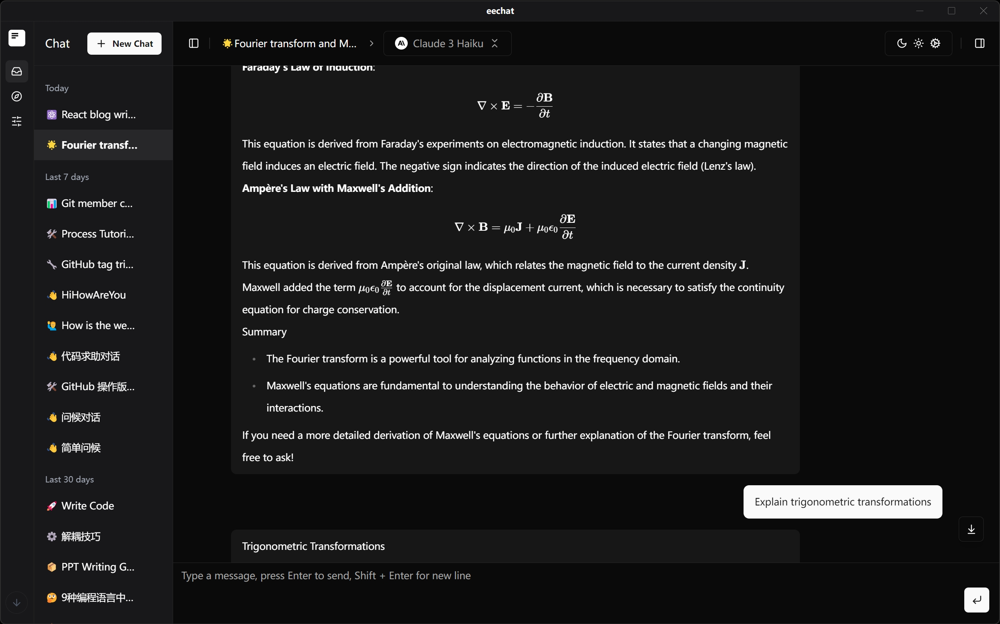
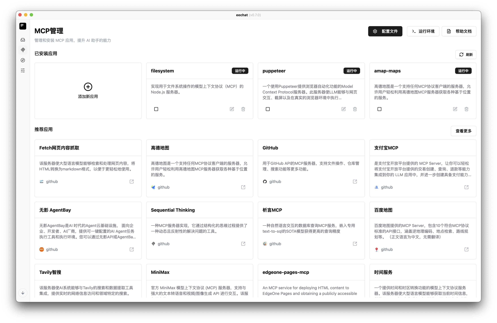
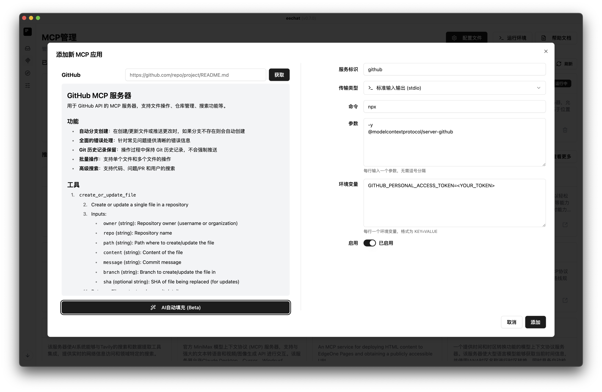
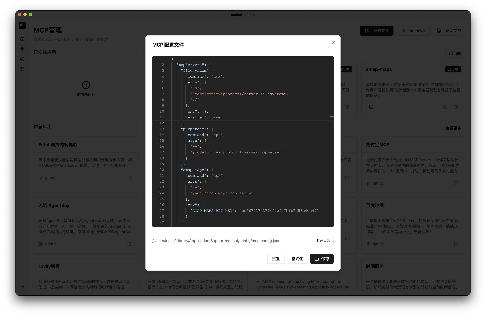
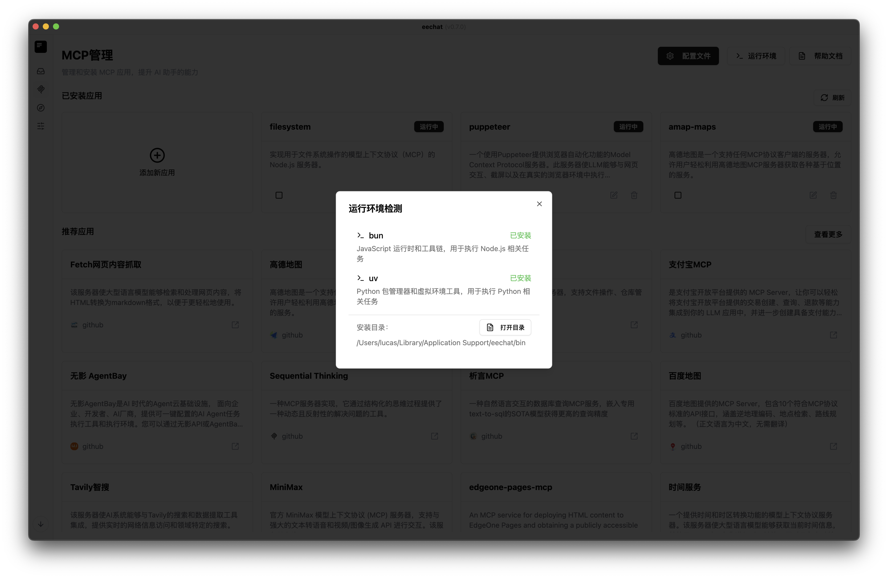
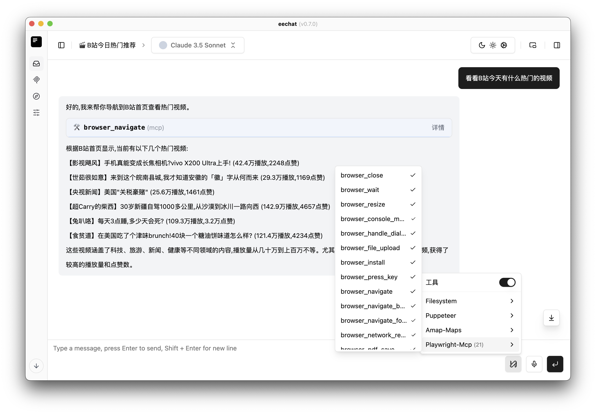
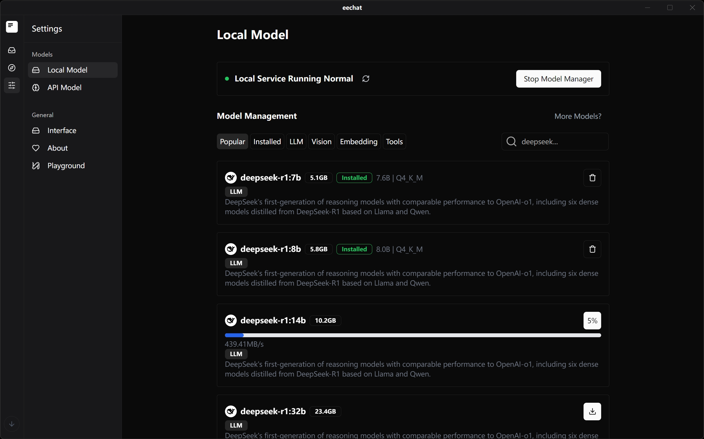
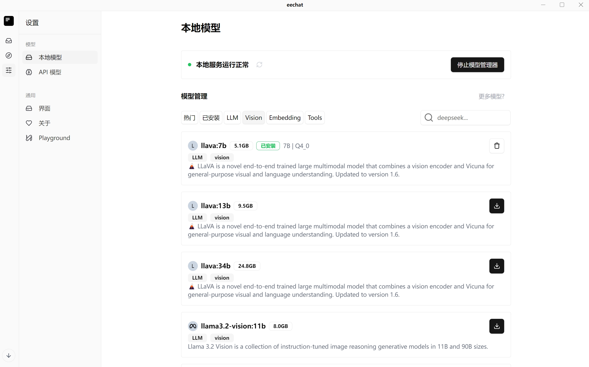

<div align="center" style="margin-bottom:40px">
<h2> 🎉 MCP feature is ready to rock!🚀</h2>
</div>
<div align="center">
  
  <h1><a href="https://ee.chat">eechat</a> </h1>
  <p>🚀 Powerful Local AI Chat Application - Secure, Efficient, Personalized</p>
  <p>  English |  <a href="./README.zh-CN.md">简体中文</a>  </p>

  <p style="margin-top:20px">
    <a href="#core-advantages">Core Advantages</a> •
    <a href="#key-features">Key Features</a> •
    <a href="#local-deployment">Local Deployment</a> •
    <a href="#quick-start">Quick Start</a> •
    <a href="#tech-stack">Tech Stack</a> •
    <a href="#contribute">Contribute</a> •
    <a href="#license">License</a>
  </p>
</div>



## Core Advantages

eechat is an AI chat application focused on local deployment, providing users with a secure, private, and efficient AI conversation experience.

### 🎉 MCP Support

MCP (Model Context Protocol) is a brand-new core extension capability of eechat, designed specifically for AI assistant scenarios. It greatly enhances the playability and professionalism of local AI. With MCP, you can easily integrate, manage, and run various AI tools and services with just one click, making your AI assistant infinitely expandable.

#### MCP Main Interface


Through the MCP management interface, you can easily view, install, start, stop, and remove various AI tools without command-line operations, significantly lowering the entry barrier.

#### MCP Visual Configuration


Provides a form-based visual way to add new MCP applications, supporting automatic README reading or AI-powered configuration filling. Even beginners can quickly integrate new tools.

#### MCP File Configuration


Built-in professional JSON configuration file editor, supporting formatting, reset, and quick navigation. Perfect for advanced users to batch manage and deeply customize. Fully compatible with Claude Desktop, Cursor, and Cline configurations.

#### Integrated Runtime Environment


Built-in automatic detection and one-click download for runtimes like bun and uv. No manual dependency setup required, ensuring Node.js/Python tools are ready to use out of the box.

#### Plugin Ecosystem & Hot-Swapping
MCP tools can be added, removed, or upgraded at any time, supporting multi-instance parallel running. Build your own exclusive AI toolbox.

#### Tool Invocation in Chat


All MCP tools can be called directly in the chat window, enabling seamless collaboration between AI and tools.

### 🔒 Data Security & Privacy Protection

- **Fully Local Storage**: All conversation data is stored locally, eliminating privacy leak risks



- **Offline Capability**: No continuous internet connection required after initial setup
- **API Customization**: Connect to your own AI model API or third-party services, maintaining full data flow control



### 💬 Superior Conversation Experience

- **Multi-Session Management**: Easily create and manage multiple independent conversations
- **History Tracking**: Automatically save all conversation history for review and continuation
- **Perfect Markdown Support**: Precise rendering of Markdown format, including code blocks, tables, and math formulas
- **Smart Code Highlighting**: Automatic code block detection and highlighting for multiple programming languages

### 🎨 Personalization Options

- **Theme Switching**: Built-in light and dark themes for different scenarios and preferences
- **Prompt Management**: Save and manage frequently used prompts to improve conversation efficiency
- **Model Parameter Tuning**: Flexibly adjust temperature, max output, and other parameters for optimal responses

### 🔌 Powerful Extensibility

- **Plugin Ecosystem**: Support for functional extensions to meet specific scenario needs
- **Multi-Model Integration**: Easy integration with various AI model APIs like OpenAI, Anthropic, etc.
- **Custom Model Support**: Configure and use custom local or remote AI models

## Key Features

### Enhanced Intelligent Conversation

- **Context Understanding**: AI maintains context coherence in long conversations
- **Multi-Turn Optimization**: Enhanced interaction experience for complex queries
- **Knowledge Base Integration**: Connect custom knowledge bases for more accurate domain-specific responses

### Developer-Friendly

- **Code Generation & Explanation**: Optimized code generation capabilities supporting multiple programming languages
- **API Documentation Generation**: Assist developers in quickly generating API documentation
- **Debug Assistance**: Help identify code issues and provide fix suggestions

### Productivity Tools

- **Document Summarization**: Quickly summarize long document content
- **Mind Map Generation**: Transform complex concepts into structured mind maps
- **Multi-Language Translation**: Support high-quality translation between multiple languages

## Local Deployment

eechat is designed for local deployment, ensuring your data security and optimal user experience.

### System Requirements

- Windows 10/11 64-bit
- macOS 10.15+
- Linux (Ubuntu 18.04+, Debian 10+)
- Minimum 4GB RAM
- 500MB available disk space
- GPU with CUDA support (optional) 8GB+ (Windows)

### Installation Methods

#### Download Pre-built Packages

Download the appropriate installation package for your system from the [releases page](https://github.com/Lucassssss/eechat/releases):

#### Build from Source

```bash
# Clone repository
git clone https://github.com/Lucassssss/eechat.git
cd eechat

# Install dependencies
pnpm install

# Run in development mode
pnpm run dev

# Build application
pnpm run build:prod
```
